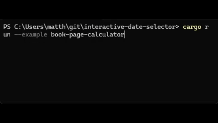

# interactive-date-selector
A small Rust library meant to allow easy selecting of a date from the command line.

# Example

# Project Status
In development. Currently works as expected and has basic UTs, but is not very configurable.

# Future Goals
- Allow for custom delimiter
- Allow for multi-language support
